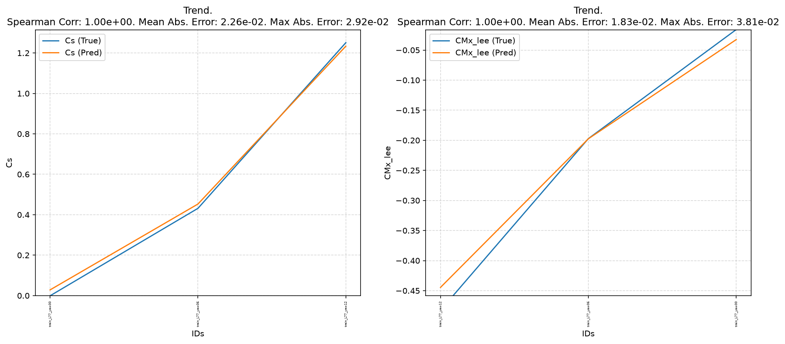
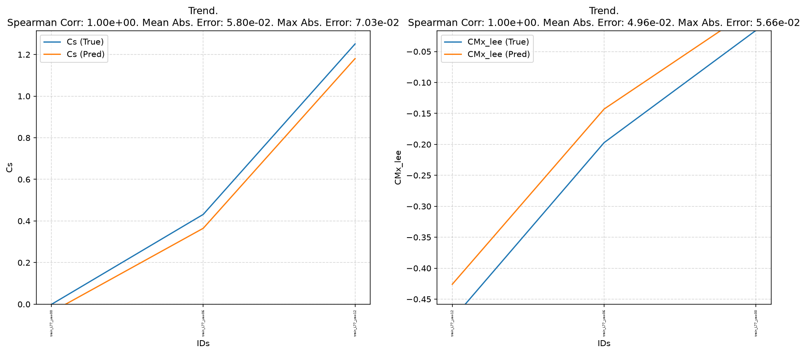
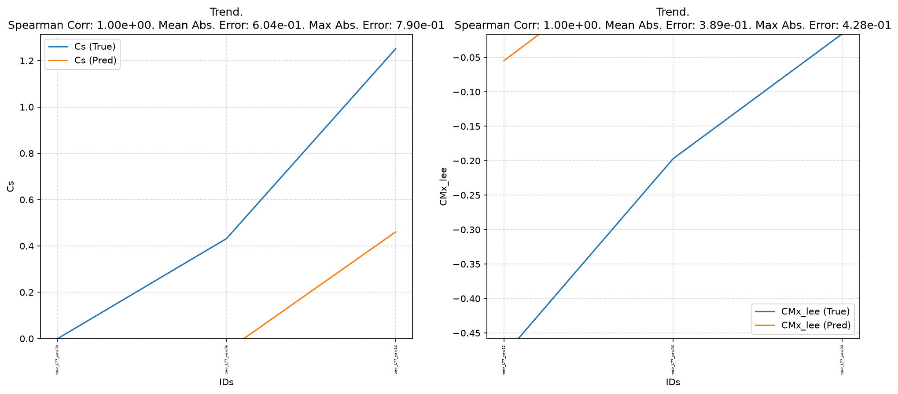

# train-aero-baselines

[](https://github.com/jkrescue/train-aero-baselines/actions/workflows/ci.yml)
[](LICENSE)


Which neural surrogate should be the baseline for **high-speed-train surface aerodynamics**?
This repository compares **GeoTransolver**, **SMART** and **AB-UPT** on the same CFD data,
trained with the official [PhysicsNeMo](https://github.com/NVIDIA/physicsnemo) external-aero
recipe and evaluated with the official
[PhysicsNeMo-CFD](https://github.com/NVIDIA/physicsnemo-cfd) benchmark pipeline.

> **Status:** interim results, 7 of 8 folds complete. Seed-noise and sensitivity runs are
> still in progress; checkpoints will be attached to the release with the final results.
> See the [report](docs/report.md) (Chinese).

## Key results

Leave-geometry-out cross-validation, seed 0, mean over folds. Cp: relative L2 on every surface
cell. C_Mx,lee: EN 14067-6 lee-rail overturning moment, |error| / truth span over the yaw sweep.

| | GeoTransolver | SMART | AB-UPT |
|---|---|---|---|
| Cp, nose family (4 folds) | 0.167 | **0.164** | 0.204 |
| Cp, length family (3 folds) | 0.161 | **0.160** | 0.664 |
| C_Mx,lee, nose family | 4.9 % | **2.4 %** | 6.3 % |
| C_Mx,lee, length family | **3.8 %** | 7.9 % | 74.6 % |
| Parameters / training time (nose, 300 epochs) | 9.05 M / 30 min | 29.45 M / 43 min | 6.01 M / 142 min |

- **AB-UPT is not recommended**: worse Cp on every fold, and it fails on unseen train lengths.
- **GeoTransolver and SMART** have indistinguishable field accuracy (paired t = −0.3 / −0.5).
  SMART predicts the overturning moment better across nose shapes, GeoTransolver across lengths.
- **Single choice: GeoTransolver**, the fastest and most balanced across both families;
  keep SMART as a second baseline for nose-shape and crosswind studies.

<p align="center">
  
  
  
</p>
<p align="center"><sub>Side force and overturning moment across the held-out 77 m train's yaw sweep
(fold l1): GeoTransolver, SMART, AB-UPT.</sub></p>

Full tables: [`results/summary.md`](results/summary.md). Method, fairness checks and
limitations: [`docs/report.md`](docs/report.md).

## How it works

```
curated CFD cases (.pdmsh) ──► PhysicsNeMo recipe src/train.py (unmodified) ──► .mdlus checkpoints
                                                                                        │
PhysicsNeMo-CFD workflows/benchmarking/main.py (unmodified) ◄───────────────────────────┘
  ├─ dataset adapter  train_aero       test cases of one fold → CanonicalCase (Cp, Cf on cells)
  ├─ model wrapper    recipe_surface   runs the recipe's own inference path inside the benchmark
  └─ metrics          built-in l2 / drag / lift + registered side_force, roll_moment(_lee)
```

The plugin ([`src/train_aero/benchmark/plugin.py`](src/train_aero/benchmark/plugin.py)) only
uses the documented `register_adapter` / `register_model` / `register_metric` extension points.

## Repository layout

```
configs/            folds.json, jobs.txt (run queue), recipe/{model,datasets}/ev_*.yaml
src/train_aero/     Python package: data prep, benchmark plugin, run orchestration, scoring
scripts/            shell entry points (run_one.sh, run_benchmark.sh, ...)
results/            published results: summary, per-fold benchmark output, figures, run metadata
data/sample/        one CFD case for tests
docs/               report.md (zh), reproduce.md, data.md, models.md
tests/              unit tests (pytest)
```

## Quick start

```bash
pip install -e ".[dev]"
pytest                      # physicsnemo-dependent tests are skipped if it is not installed
```

Training and evaluation need PhysicsNeMo, PhysicsNeMo-CFD and the full dataset:

```bash
cp .env.example .env                                  # set the checkout and data paths
python -m train_aero.data.prepare && python -m train_aero.data.make_folds
scripts/run_one.sh 0 n2 gt 0 -                        # train + infer one run on GPU 0
scripts/run_benchmark.sh 0                            # PhysicsNeMo-CFD benchmark + summary
```

Step-by-step instructions: [`docs/reproduce.md`](docs/reproduce.md).

## Checkpoints and data

- **Checkpoints**: final `.mdlus` of every run as
  [release assets](https://github.com/jkrescue/train-aero-baselines/releases), indexed with
  SHA-256 in [`results/checkpoints.json`](results/checkpoints.json); see [`docs/models.md`](docs/models.md).
- **Data**: 44 OpenFOAM cases (9 nose shapes, 5 lengths, yaw 0–12°); only one sample case is
  included. See [`docs/data.md`](docs/data.md).

## Acknowledgements

Built on [NVIDIA PhysicsNeMo](https://github.com/NVIDIA/physicsnemo) and
[PhysicsNeMo-CFD](https://github.com/NVIDIA/physicsnemo-cfd); the three models are their
implementations.

## License

[Apache-2.0](LICENSE)
