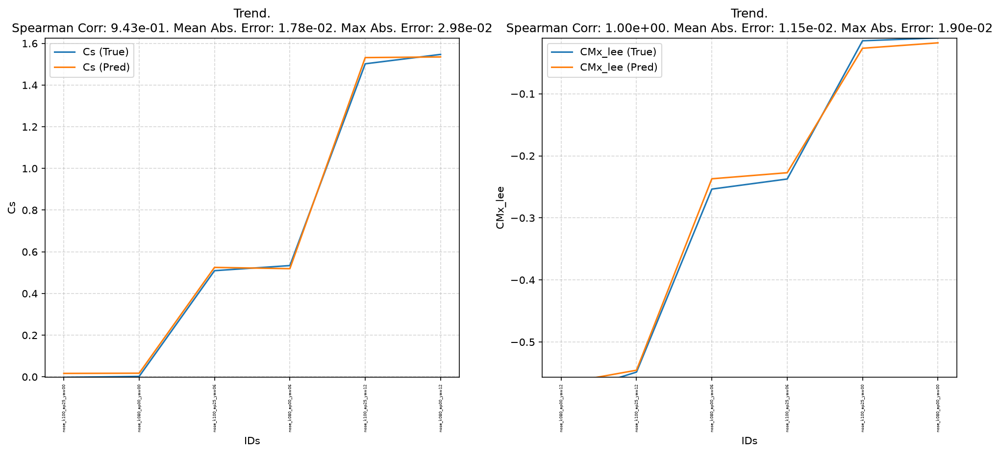
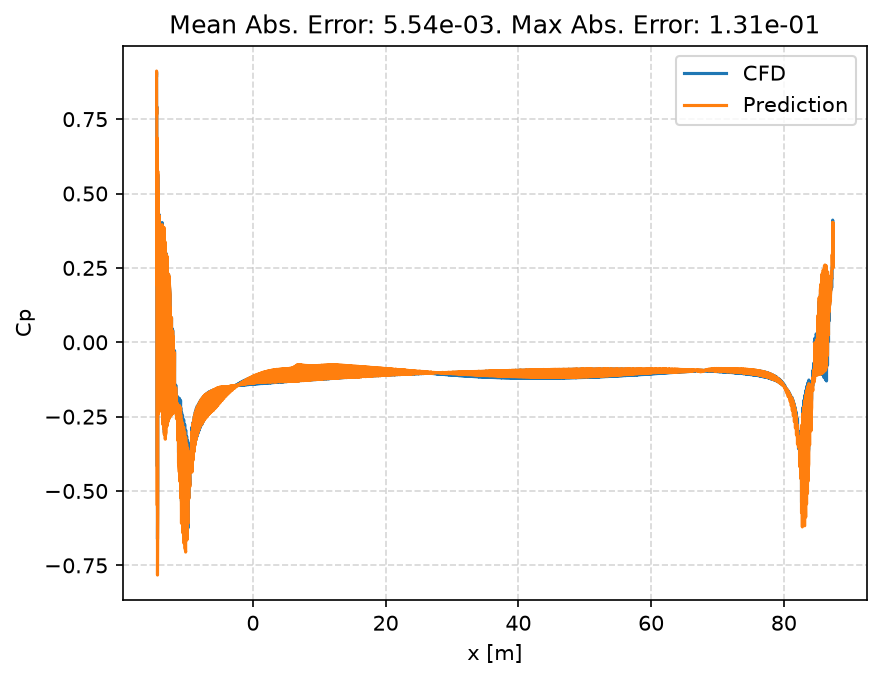

# 列车气动代理模型：基线模型选型评估（GeoTransolver / AB-UPT / SMART）

> 状态：**最终版本（2026-11-19）。8 个折的全部运行（主表、多种子、敏感性、对照）均已完成并经 pipeline 评测。**
> 评估日期：2026-11-18 至 2026-11-19。代码与配置见本仓库，数值结果见 [`results/`](../results/)，复现步骤见 [reproduce.md](reproduce.md)。
> 本文是这次评估的唯一报告：方法、检查、结果、结论都在这里。

## 0. 结论摘要

**结论（8 / 8 折全部完成）：AB-UPT 不适合作为基线；GeoTransolver 与 SMART 在场精度和工程积分量上
都没有超出种子噪声的差别，推荐 GeoTransolver 作为主基线。**

| 维度 | GeoTransolver | SMART | AB-UPT |
|---|---|---|---|
| Cp 场误差（车头族 5 折 / 长度族 3 折） | 0.157 / 0.161 | 0.154 / 0.160 | 0.191 / 0.664 |
| 背风轨倾覆力矩误差 / 偏航跨度（车头族 / 长度族） | 4.2% / 3.8% | 3.0% / 7.9% | 5.5% / 74.6% |
| 种子噪声（n2、l2 各 3 个种子，Cp 标准差） | 0.003–0.007 | 0.006–0.007 | — |
| 按折配对比较 | — | Cp 与 GeoTransolver 差 −0.003 / −0.001（t = −0.3 / −0.5），小于种子噪声 | Cp 在全部 8 折上都比另两者差（车头族 t = +5.7） |
| 训练成本（车头族 300 轮） | 31 分钟，17 GB，9.05 M 参数 | 44 分钟，10.5 GB，29.45 M 参数 | 146 分钟，18–19 GB，6.01 M 参数 |

- **AB-UPT**：车头族 Cp 平均落后 0.034，约为种子标准差的 5 倍；训练时间是 GeoTransolver 的 4.7 倍。
  对没见过的车长完全失败：Cp 误差 0.57–0.73，比不学习的基线还差。坐标居中只能部分改善（6.5 节）。
- **GeoTransolver 与 SMART**：Cp、Cf 场误差的配对差远小于种子噪声。种子 0 上看到的倾覆力矩
  “各族各有所长”不稳定：同一折不同种子的倾覆力矩误差可从 1.1% 变到 15.0%；n2 上 3 个种子平均后，
  种子 0 时占优的 SMART 反而稍差（3.9% 对 3.1%）（6.3 节）。
- **推荐 GeoTransolver**：精度与 SMART 相当，训练最快、参数最少，已有工作的配置和验证可直接沿用。
  SMART 显存需求更低，可作为第二基线。

## 1. 问题

在**同一份 CFD 数据**上，GeoTransolver、AB-UPT、SMART 三个模型中，哪一个更适合作为
列车表面气动场预测的基线模型。

## 2. 数据

沿用已有的 44 个 OpenFOAM 算例（`simpleFoam` + k-ω SST，400 km/h），详见 [数据说明](data.md)。

| 族 | 算例 | 几何变化 | 工况变化 |
|---|---|---|---|
| 车头型线族 | 27 | 9 种鼻锥，车长和迎风面积相同 | 偏航 0° / 6° / 12° |
| 编组长度族 | 17 | 5 种车长 52–152 m | 偏航 0° / 6° / 12°（102 m 另有 3°、9°） |

来流速度只有一个值（111.11 m/s），所以"不同来流"在本数据中等于不同偏航角（侧风）。
预测目标：表面压力系数 Cp（1 通道）和摩擦系数 Cf（3 通道）。每个 102 m 列车约 13.9 万个表面单元。

## 3. 评测框架

训练和评测都只用 NVIDIA 官方代码：训练走 PhysicsNeMo 的统一外流气动 recipe，
评测走 **PhysicsNeMo-CFD 的 benchmark pipeline**。数据和模型是我们自己的。

```
 我们的 CFD 数据 (.pdmsh)                         我们训练的检查点 (.mdlus)
        │                                                  ▲
        │  PhysicsNeMo recipe: src/train.py（未修改）───────┘
        │
        ▼
 PhysicsNeMo-CFD benchmark pipeline: workflows/benchmarking/main.py（未修改，Hydra 入口）
   ├─ 数据适配器 train_aero ........ 读入一个折的测试工况 → CanonicalCase（表面单元 Cp / Cf）
   ├─ 模型包装器 recipe_surface .... 载入检查点，在 pipeline 内做推理
   ├─ 指标 ......................... 内置 l2_pressure / l2_pressure_area_weighted / l2_shear_stress
   │                                 / drag / lift；注册 side_force / roll_moment / roll_moment_lee
   └─ 报告 ......................... benchmark_results.{json,csv,html}、表面场对比图、中心线 Cp、
                                     积分量随工况变化图（design_trend / design_scatter）
```

### 3.1 训练：PhysicsNeMo recipe

| 项目 | 内容 |
|---|---|
| 代码 | PhysicsNeMo 上游 main，提交 `fb5b9a2` |
| recipe | `examples/cfd/external_aerodynamics/unified_external_aero_recipe`，三个模型只换 `model=` |
| 环境 | Python 3.12，torch 2.14.0+cu130 |
| 入口 | 官方 `src/train.py`，未修改 `src/` 下任何文件 |
| GeoTransolver | `physicsnemo.models.geotransolver.GeoTransolver` |
| AB-UPT | `physicsnemo.experimental.models.ab_upt.ABUPT`（NVIDIA 独立实现，Apache-2.0） |
| SMART | `physicsnemo.experimental.models.smart.SMART`（NVIDIA 独立实现，Apache-2.0） |
| 检查点 | 官方 `.mdlus` 格式 |

对 recipe 的改动只有：新增以 `ev_` 开头的配置文件，以及在 `datasets/dataset_paths.yaml`
里登记数据路径（该文件本来就是让使用者填写的）。新增配置见 [`configs/recipe/`](../configs/recipe/)，由 `train_aero.data.make_folds` 生成。

### 3.2 评测：PhysicsNeMo-CFD benchmark pipeline

| 项目 | 内容 |
|---|---|
| 代码 | PhysicsNeMo-CFD，提交 `43e531a`，以可编辑方式安装（只新增依赖，未改动已有包） |
| 入口 | 官方 `workflows/benchmarking/main.py`，原样执行。`train_aero.benchmark.launch` 只做一件事：先 import 插件完成注册，再用 `runpy` 执行 `main.py` |
| 配置 | 每折一份 `bench/conf/train_aero_<折>.yaml`，格式与官方 `conf/config_matrix_surface_custom.yaml` 相同，由 `train_aero.benchmark.configs` 生成 |
| 插件 | [`train_aero.benchmark.plugin`](../src/train_aero/benchmark/plugin.py)，只用 benchmark README 说明的扩展点（`register_adapter` / `register_model` / `register_metric`），physicsnemo-cfd 的文件一个都没改 |
| 输出 | 工作目录 `bench/results/<折>/`：`benchmark_results.{json,csv,html}`、`visuals/*.png`、`hydra/`（完整配置留档）；发布副本在 [`results/benchmark/`](../results/benchmark/) 和 [`results/figures/`](../results/figures/) |
| 汇总 | `train_aero.benchmark.summarize` → [`results/summary.md`](../results/summary.md) |
| 一键运行 | `scripts/run_benchmark.sh` |

**数据适配器 `train_aero`**：把一个折的测试工况读成 `CanonicalCase`。几何是整网格表面
（米制坐标），真值是表面单元上的 Cp、Cf。网格同时写成 `bench/truth/<族>/<工况>.vtp`。

**模型包装器 `recipe_surface`**：在 pipeline 内做推理，不读事先算好的预测。

- **载入**：读取训练产出的 `.mdlus` 检查点，以及该次运行的 recipe 推理配置 `bench_infer_config.yaml`。
  该配置由官方 `conf/infer.yaml` 加上与训练时一致的覆盖项组合而成。
- **数据处理**：调用 recipe 自己的 `build_dataloaders`、`collate_fn` 和输出整理函数；
  反归一化、反无量纲化直接 import `infer.py` 的函数，不复制代码，保证预处理与训练完全一致。
- **对齐**：模型输出点按位置一一映射回真值单元（要求逐一对应、距离 < 1 mm），再换算成 Cp / Cf。

**指标**：

| 指标 | 来源 | 说明 |
|---|---|---|
| `l2_pressure` | 内置 | Cp 相对 L2（逐单元） |
| `l2_pressure_area_weighted` | 内置 | Cp 相对 L2（按单元面积加权） |
| `l2_shear_stress` | 内置 | Cf 三个分量各自的相对 L2 |
| `drag`、`lift` | 内置 | 积分阻力、升力系数，`coeff = 1 / A_ref`（A_ref = 11.0888 m²） |
| `side_force` | 注册 | 复用内置 `lift`，方向改为 +y |
| `roll_moment`、`roll_moment_lee` | 注册 | 绕轨道中心线的滚转力矩、绕背风轨的倾覆力矩（EN 14067-6），用 `train_aero.physics` 的积分 |

**积分量误差口径**：pipeline 给出的力误差是 |预测 − 真值| / |真值|。侧力和倾覆力矩在
偏航 0° 时真值接近 0，这个比值会到几十倍，没有意义。因此汇总时：

- 阻力用 pipeline 的相对误差（Cd 不会接近 0）。
- 侧力、升力、倾覆力矩用 pipeline 输出的逐工况真值和预测，计算"|误差| / 该几何偏航扫描的真值跨度"。

**报告图**（每折一个 12° 工况）：表面 Cp 对比（`field_comparison_surface`）、
中心线 Cp（`line_plot_centerlines`）、侧力和倾覆力矩随工况变化（`design_trend`）、
积分量真值对预测（`design_scatter`）。

### 3.3 pipeline 的正确性验证

| 检查 | 结果 |
|---|---|
| pipeline 内推理 vs recipe 官方 `infer.py` | GeoTransolver、SMART 的 Cp 误差逐位一致（n2：0.1409 / 0.1297）。AB-UPT 推理时随机抽取超节点，两次结果有 ±0.001 量级的差别（0.1808 对 0.1821） |
| 力的符号约定 | pipeline 的 `compute_drag_and_lift` 用 pyvista 计算法向。真值 VTP 保持原始单元顺序时法向朝里，此时 Cd / Cs / Cl = 0.22341 / 0.53385 / 0.16958（`nose_k080_ap00_yaw06`），与已对照 OpenFOAM `forceCoeffs` 验证过的 `train_aero.physics` 完全一致（`tests/test_physics_sample.py`）。若把单元顺序反转，压力项会变号，结果就错了 |
| 真值往返 | `infer.py` 写出的真值场映射回去后与原始 Cp / Cf 的相对差 ≤ 3e-8，三个模型相同 |
| 点对应 | 所有运行、所有工况都一一对应，最大距离 < 6e-6 m |
| 与自写打分脚本交叉验证 | `train_aero.runs.score` 的 Cp 相对 L2 与 pipeline 的 `l2_pressure` 逐位一致 |

## 4. 评估协议

### 4.1 划分：按几何留出

同一几何的全部偏航角永远在同一侧。

| 折 | 族 | 留出的几何 | 性质 | 训练 / 验证 / 测试 |
|---|---|---|---|---|
| n1 | 车头 | k=0.60；a=−0.25 | 外推 + 内插 | 20 / 1 / 6 |
| n2 | 车头 | k=0.80；a=+0.25 | 内插（同时用于学习率搜索） | 20 / 1 / 6 |
| n3 | 车头 | k=1.30；a=−0.50 | 内插 + 外推 | 20 / 1 / 6 |
| n4 | 车头 | k=1.60；a=+0.50 | 外推 | 20 / 1 / 6 |
| n5 | 车头 | 原型（k=1, a=0） | 中心点 | 23 / 1 / 3 |
| l1 | 长度 | 77 m | 内插 | 13 / 1 / 3 |
| l2 | 长度 | 127 m | 内插（与旧结果同一留出） | 13 / 1 / 3 |
| l3 | 长度 | 152 m | 外推 | 13 / 1 / 3 |

车头型线族的 9 个几何在 n1–n5 中各被测试恰好一次。验证集只有 1 个样本，仅用于监控，
不用于选检查点。

### 4.2 三种"点数"

| 角色 | 处理 | 取值 |
|---|---|---|
| 评估点 | 三个模型完全一致 | 整网格全部单元（7.8–20 万） |
| 监督点（每步参与损失的查询点） | 对齐 | 32 000 |
| 内部 token | 各自官方默认，不对齐 | AB-UPT：65 536 几何点 / 16 384 超节点 / 16 384 锚点；SMART：16 384 几何子采样 / 2 048 潜变量；GeoTransolver：256 切片 |

另在 n2 折做监督点扫描（16k / 32k / 64k），检查排名是否随点数变化。

### 4.3 训练设置

| 项目 | 取值 | 说明 |
|---|---|---|
| 轮数 | 300 | 与已有 GeoTransolver 结果一致 |
| 调度器 | StepLR，第 150 轮 ×0.1 | 三个模型相同 |
| 精度 / 编译 | float32 / 关闭 | 三个模型相同 |
| 批大小 | 1 | recipe 固定 |
| 优化器、学习率、损失 | 各自官方默认 | GeoTransolver 3e-3（Huber）；AB-UPT 1e-4（Huber）；SMART 1e-3（MSE） |
| 损失 / 指标加权 | `measure_weighted=false`（逐单元） | 上游默认已改为按面积加权，见 5.3；n2 折另跑面积加权对照 |
| 学习率搜索 | 每个模型 ×1/3、×1、×3，n2 折 | 相同搜索预算 |
| 检查点 | 取最后一轮 | 不按测试集挑选 |
| 数据增强 | 无 | 旋转增强会破坏偏航信息 |

### 4.4 统计判据

- 模型间差异：按折配对比较，报告平均差、标准差、t = 平均差 / 标准误，以及胜负折数。
- 种子噪声：在 n2 和 l2 上对 GeoTransolver、SMART 各跑 3 个种子。
- 差距需超过 2 倍种子噪声才视为显著。
- 参照：不学习的基线（最近型线、型线插值、训练集平均、全场常数），取各折最好的一个。
  基线由 `train_aero.baselines` 计算（结果见 [`results/baselines/`](../results/baselines/)），Cp 相对 L2 的定义与 pipeline 的 `l2_pressure` 相同。

**与最初方案的差别**：

- 最初计划每折 3 个种子。实测 GPU 计算是瓶颈（同卡并行没有吞吐收益），全量需三天以上，
  因此改为"每折 1 个种子 + n2、l2 两个折上 3 个种子"。
- AB-UPT 在主结果上已明确落后（见第 6 节），它的多种子、点数扫描、面积加权对照
  共约 15 GPU 小时，不会改变结论，已从队列中撤下（见 [`configs/jobs.txt`](../configs/jobs.txt) 末尾注释）。

## 5. 公平性与已知问题检查

### 5.1 此前工作中记录的已知问题

| 已知问题 | 本次的处理 | 验证 |
|---|---|---|
| `simpleFoam` 的 p、wallShearStress 是运动量 | 沿用已乘密度的 `.pdmsh` | 真值往返 ≤ 3e-8（3.3 节） |
| wss 必须归一化 | 三个模型用同一个标准差，每折只用训练集计算 | `train_aero.runs.inspect_inputs n2`：三者目标张量统计一致 |
| 不能开旋转增强 | 配置中为空 | 解析后的配置 |
| 官方读取取连续一段单元 | 训练用打乱存储顺序的数据集 | 输入坐标范围覆盖整车 |
| 汽车量级的常数 | 见 5.2 | — |
| 模型可能静默读不到来流 | 三个模型都显式接入工况输入 | 侧力、倾覆力矩符号；随偏航变化的趋势图 |
| 推理必须走官方代码 | pipeline 内推理调用 recipe 自己的函数 | 与 `infer.py` 逐位一致 |
| 不要编辑正在运行的脚本 | 修改脚本一律写新文件再原子替换 | — |

### 5.2 对官方配置的改动（全部）

| 模型 | 改动 | 原因 |
|---|---|---|
| 三个模型 | 工况输入由 `global_data.U_inf` 改为 `global_data.U_hat`（单位方向） | 原始向量为 (111, 0–23.6, 0) m/s，SMART 的参数调制没有输入缩放，接入后损失在 0.7–6 之间震荡。单位方向是同一信息的无量纲形式（速度大小在本数据中恒定），三个模型得到相同的、量级为 1 的输入 |
| 三个模型 | `measure_weighted=false` | 上游提交 `d919d80` 把默认改成了面积加权，见 5.3 |
| SMART | 启用 `parameter_channels: 3` 并接入工况输入 | 官方表面配置没有工况输入；本数据中偏航是核心变量 |
| SMART | `coordinate_scale`：车头族 [2.6, 0.068, 0.085]，长度族 [2.6, 0.134, 0.168] | 官方值 [2.4, 0.9, 0.65] 是汽车包围盒的约 2.6 / 2.2 / 2.3 倍；对列车包围盒取相同倍数 |
| AB-UPT | `pooling_radius`：0.03125 → 0.0098 | 官方值在汽车上是 0.156 m（约 170 个邻居）；坐标按车长归一化后，同一数值在列车上是 3.2 m（整个车宽）。按相同期望邻居数换算为 1.0 m |
| AB-UPT | `pooling_chunk_size`、`query_chunk_size` 调大 | 只限制单次运算的显存，不改变结果 |
| AB-UPT | 新写 point-sets 数据集配置 | 官方只提供 DrivAerML 的；照其结构改了路径、文件匹配、字段名和 wss 标准差 |
| GeoTransolver | 结构固定为旧版表面配置：`include_local_features: false`，`radii: [0.1, 0.5, 2.0]`，`neighbors_in_radius: [16, 32, 64]`（9.05 M 参数） | 上游提交 `762daaf` 把默认改成了带局部特征、6 档半径的 27.6 M 模型，在列车数据上更差，见 5.3 |

**一处不对称**：AB-UPT 的官方读取链不做 `CenterMesh`，坐标未居中；GeoTransolver 和 SMART
居中。主结果保留各自官方数据契约，另做了"AB-UPT + 居中"的对照（6.5 节）。

### 5.3 回归闸门：新环境能否复现旧结果

正式评估前，先在新环境（上游 `fb5b9a2`）用旧划分、旧数据、种子 0 重训 GeoTransolver，
与旧结果比较。旧结果 3 个种子的 Cp 范围是 0.1381–0.1408。

| 运行 | 结构 | 损失加权 | Cp 相对 L2 | wss 相对 L2 | 参数量 | 显存 | 秒/步 |
|---|---|---|---|---|---|---|---|
| 旧环境（`289e573`） | 旧 | 不加权 | 0.1399 | 0.0943 | 9.05 M | 17 GB | 0.29 |
| v1：上游默认 | 新 | 面积加权 | 0.1771 | 0.0980 | 27.57 M | 27 GB | 0.54 |
| v2 | 旧 | 不加权 | **0.1399** | **0.0943** | 9.05 M | 17.3 GB | 0.29 |
| v3 | 新 | 不加权 | 0.1517 | 0.0951 | 27.57 M | 27 GB | 0.53 |

- **v2 与旧结果逐位一致**：新环境、数据副本（增加了 `U_hat` 字段）和打分都没有引入差异。
- **上游静默改了两个默认值**，都不报错：`measure_weighted: true`（`d919d80`）和 GeoTransolver 表面配置（`762daaf`）。
- **新结构在列车上更差**：0.1517 对 0.1399，训练还慢约 1.8 倍。新增的最小半径 0.01 按车长归一化后约 1 m，是为汽车尺度设的。
- **面积加权再使 Cp 误差升到 0.1771**：列车网格在车头加密，面积加权降低了车头小单元的权重。

正式评估采用 v2 的设置。局限：GeoTransolver 的结构是在旧划分的测试几何上二选一得到的，
有轻微的选择偏差；AB-UPT 和 SMART 没有做对应的结构选择。

### 5.4 运行环境上的问题

- **Warp 在 WSL 下看不到 GPU**：需要 `LD_LIBRARY_PATH=/usr/lib/wsl/lib`。
- **WSL 会杀掉脱离会话的进程**：通过 SSH 启动的 `nohup` / `tmux` 任务在会话结束后被回收，
  改为在 Windows 侧用 `Win32_Process.Create` 启动 `wsl.exe`。
- **同卡并行无收益**：GPU 计算是瓶颈，队列改为每张卡一次一个任务。
- **推理配置不接受训练覆盖项**：学习率扫描的运行推理时报 `Key 'lr' is not in struct`，
  已改为推理时不传 `training.*` 覆盖项并补跑。

## 6. 结果（全部来自 PhysicsNeMo-CFD benchmark pipeline）

数据源：[`results/benchmark/<折>/benchmark_results.json`](../results/benchmark/)，
汇总表 [`results/summary.md`](../results/summary.md)，逐次运行的配置与训练曲线见 [`results/runs/`](../results/runs/)。

### 6.1 主表：逐折结果（种子 0，默认设置）

Cp / τ 为相对 L2；Cd 为相对误差；Cs、Cl、C_Mx,lee 为 |误差| / 该几何偏航扫描的真值跨度（3.2 节）。
“基线”为该折最好的不学习基线的 Cp 相对 L2。

**车头型线族**

| 折 | 模型 | Cp L2 | Cp L2（面积加权） | τx L2 | τy L2 | τz L2 | Cd 误差 | Cs 误差/跨度 | Cl 误差/跨度 | C_Mx,lee 误差/跨度 | 基线 Cp |
|---|---|---|---|---|---|---|---|---|---|---|---|
| n1 | GeoTransolver | **0.1684** | **0.1549** | 0.0923 | 0.2890 | 0.2409 | 5.0% | 3.9% | 2.0% | 7.2% | 0.3846 |
| n1 | SMART | 0.1933 | 0.1710 | 0.0947 | 0.3061 | 0.2484 | 8.7% | 1.7% | 3.7% | 2.8% | |
| n1 | AB-UPT | 0.2054 | 0.1994 | 0.0988 | 0.3035 | 0.2765 | 8.1% | 6.8% | 6.9% | 9.9% | |
| n2 | GeoTransolver | 0.1409 | 0.1322 | 0.0791 | 0.2314 | 0.2074 | 4.5% | 2.4% | 4.1% | 3.6% | 0.2798 |
| n2 | SMART | **0.1297** | **0.1168** | 0.0755 | 0.2253 | 0.2055 | 3.5% | 1.2% | 4.9% | 2.0% | |
| n2 | AB-UPT | 0.1808 | 0.1724 | 0.0970 | 0.2619 | 0.2602 | 1.8% | 3.4% | 5.8% | 3.9% | |
| n3 | GeoTransolver | 0.1512 | 0.1342 | 0.0862 | 0.2514 | 0.2205 | 3.8% | 1.3% | 1.5% | 2.1% | 0.3649 |
| n3 | SMART | **0.1470** | **0.1336** | 0.0886 | 0.2545 | 0.2177 | 4.3% | 0.6% | 2.4% | 1.9% | |
| n3 | AB-UPT | 0.2030 | 0.2013 | 0.0920 | 0.2535 | 0.2568 | 1.9% | 2.2% | 6.5% | 1.5% | |
| n4 | GeoTransolver | 0.2080 | 0.1925 | 0.0980 | 0.2513 | 0.2495 | 3.4% | 3.6% | 6.0% | 6.8% | 0.4382 |
| n4 | SMART | **0.1856** | **0.1681** | 0.0937 | 0.2527 | 0.2437 | 2.3% | 0.5% | 5.2% | 2.9% | |
| n4 | AB-UPT | 0.2261 | 0.2197 | 0.0994 | 0.2656 | 0.2642 | 4.5% | 4.3% | 6.1% | 9.8% | |
| n5 | GeoTransolver | 0.1143 | **0.0987** | 0.0764 | 0.2274 | 0.1777 | 1.5% | 0.7% | 0.6% | 1.5% | 0.3136 |
| n5 | SMART | **0.1138** | 0.0999 | 0.0731 | 0.2211 | 0.1827 | 3.2% | 2.1% | 4.1% | 5.6% | |
| n5 | AB-UPT | 0.1383 | 0.1260 | 0.0882 | 0.2646 | 0.2015 | 4.2% | 0.8% | 2.2% | 2.6% | |

**编组长度族**

| 折 | 模型 | Cp L2 | Cp L2（面积加权） | τx L2 | τy L2 | τz L2 | Cd 误差 | Cs 误差/跨度 | Cl 误差/跨度 | C_Mx,lee 误差/跨度 | 基线 Cp |
|---|---|---|---|---|---|---|---|---|---|---|---|
| l1 | GeoTransolver | 0.1366 | **0.1209** | 0.0716 | 0.1817 | 0.1915 | 4.6% | 1.8% | 6.3% | 3.9% | 0.4439 |
| l1 | SMART | **0.1329** | 0.1216 | 0.0697 | 0.1765 | 0.1970 | 2.1% | 4.6% | 3.4% | 10.6% | |
| l1 | AB-UPT | 0.7288 | 0.7536 | 0.1940 | 0.6629 | 0.7376 | 54.8% | 48.2% | 27.7% | 83.3% | |
| l2 | GeoTransolver | 0.1765 | **0.1229** | 0.0529 | 0.1663 | 0.1707 | 1.3% | 1.3% | 4.1% | 1.1% | 0.2544 |
| l2 | SMART | **0.1723** | 0.1255 | 0.0548 | 0.1717 | 0.1624 | 1.1% | 2.8% | 5.0% | 3.0% | |
| l2 | AB-UPT | 0.5701 | 0.5686 | 0.1376 | 0.4939 | 0.5855 | 4.5% | 8.8% | 68.0% | 55.7% | |
| l3 | GeoTransolver | **0.1695** | **0.1515** | 0.0731 | 0.2337 | 0.2132 | 0.6% | 5.9% | 15.1% | 6.2% | 0.2352 |
| l3 | SMART | 0.1737 | 0.1557 | 0.0767 | 0.2488 | 0.2224 | 2.0% | 5.3% | 5.9% | 10.2% | |
| l3 | AB-UPT | 0.6926 | 0.7057 | 0.1564 | 0.5909 | 0.7382 | 12.2% | 32.6% | 70.9% | 84.7% | |

**按折平均**

| 族（折数） | 模型 | Cp L2 | Cp L2（面积加权） | τx L2 | τy L2 | τz L2 | Cd 误差 | Cs 误差/跨度 | Cl 误差/跨度 | C_Mx,lee 误差/跨度 | Cs 符号正确 | C_Mx,lee 符号正确 |
|---|---|---|---|---|---|---|---|---|---|---|---|---|
| 车头（5） | GeoTransolver | 0.1566 | 0.1425 | 0.0864 | 0.2501 | 0.2192 | 3.6% | 2.4% | 2.8% | 4.2% | 100% | 100% |
| 车头（5） | SMART | **0.1539** | **0.1379** | 0.0851 | 0.2519 | 0.2196 | 4.4% | **1.2%** | 4.1% | **3.0%** | 100% | 100% |
| 车头（5） | AB-UPT | 0.1907 | 0.1838 | 0.0951 | 0.2698 | 0.2518 | 4.1% | 3.5% | 5.5% | 5.5% | 100% | 100% |
| 长度（3） | GeoTransolver | 0.1609 | **0.1318** | 0.0659 | 0.1939 | 0.1918 | 2.2% | **3.0%** | 8.5% | **3.8%** | 100% | 100% |
| 长度（3） | SMART | **0.1596** | 0.1342 | 0.0671 | 0.1990 | 0.1939 | 1.7% | 4.3% | 4.8% | 7.9% | 100% | 100% |
| 长度（3） | AB-UPT | 0.6638 | 0.6760 | 0.1627 | 0.5826 | 0.6871 | 23.8% | 29.9% | 55.5% | 74.6% | 83% | 83% |

三个模型在所有折上都明显优于不学习的基线，只有 AB-UPT 在长度族例外。

### 6.2 按折配对比较

正值表示前一个模型更差。

| 族 | 比较 | 指标 | 折数 | 平均差 | 标准差 | t | 前者更差的折数 |
|---|---|---|---|---|---|---|---|
| 车头 | SMART − GeoTransolver | Cp L2 | 5 | −0.0027 | 0.0176 | −0.34 | 1/5 |
| 车头 | SMART − GeoTransolver | C_Mx,lee 误差/跨度 | 5 | −0.0119 | 0.0339 | −0.79 | 1/5 |
| 车头 | AB-UPT − GeoTransolver | Cp L2 | 5 | +0.0342 | 0.0134 | +5.72 | 5/5 |
| 车头 | AB-UPT − GeoTransolver | C_Mx,lee 误差/跨度 | 5 | +0.0130 | 0.0152 | +1.92 | 4/5 |
| 车头 | AB-UPT − SMART | Cp L2 | 5 | +0.0368 | 0.0184 | +4.48 | 5/5 |
| 车头 | AB-UPT − SMART | C_Mx,lee 误差/跨度 | 5 | +0.0250 | 0.0445 | +1.25 | 3/5 |
| 长度 | SMART − GeoTransolver | Cp L2 | 3 | −0.0012 | 0.0047 | −0.45 | 1/3 |
| 长度 | SMART − GeoTransolver | C_Mx,lee 误差/跨度 | 3 | +0.0416 | 0.0243 | +2.96 | 3/3 |
| 长度 | AB-UPT − GeoTransolver | Cp L2 | 3 | +0.5030 | 0.1008 | +8.64 | 3/3 |
| 长度 | AB-UPT − GeoTransolver | C_Mx,lee 误差/跨度 | 3 | +0.7078 | 0.1409 | +8.70 | 3/3 |
| 长度 | AB-UPT − SMART | Cp L2 | 3 | +0.5042 | 0.0998 | +8.75 | 3/3 |
| 长度 | AB-UPT − SMART | C_Mx,lee 误差/跨度 | 3 | +0.6662 | 0.1212 | +9.52 | 3/3 |

- **Cp 场误差**：SMART 与 GeoTransolver 没有可区分的差别（|t| < 0.5，两族各只有 1 个折 SMART 更差）。
- **倾覆力矩**：车头族 SMART 平均好 1.2 个百分点，但方向不一致（t = −0.8；n5 折 GeoTransolver 明显更好）。
  长度族 GeoTransolver 3/3 折更好（t = +3.0），但 4.2 个百分点的差值没有超过 2 倍种子噪声（6.3 节），
  不足以据此取舍。
- **AB-UPT**：Cp 在全部 8 个折上都落后。

### 6.3 种子噪声

GeoTransolver、SMART 在 n2、l2 上各跑种子 0、1、2，其余设置与主表相同。

| 折 | 模型 | Cp L2（种子 0 / 1 / 2） | Cp 均值 ± 标准差 | C_Mx,lee 误差/跨度（种子 0 / 1 / 2） | C_Mx,lee 均值 |
|---|---|---|---|---|---|
| n2 | GeoTransolver | 0.1409 / 0.1333 / 0.1280 | 0.1341 ± 0.0065 | 3.6% / 3.2% / 2.4% | 3.1% |
| n2 | SMART | 0.1297 / 0.1303 / 0.1414 | 0.1338 ± 0.0066 | 2.0% / 4.3% / 5.5% | 3.9% |
| l2 | GeoTransolver | 0.1765 / 0.1827 / 0.1793 | 0.1795 ± 0.0031 | 1.1% / 15.0% / 4.1% | 6.7% |
| l2 | SMART | 0.1723 / 0.1834 / 0.1778 | 0.1778 ± 0.0055 | 3.0% / 5.0% / 9.4% | 5.8% |

- **Cp**：种子标准差 0.003–0.007。GeoTransolver 与 SMART 的折平均差（0.003 / 0.001）远小于此；
  3 个种子平均后，两者在 n2、l2 上只差 0.0003 和 0.0017。AB-UPT 的差距（车头族 0.034，长度族 0.50）
  远超种子噪声，这一结论是稳定的。
- **倾覆力矩**：对种子很敏感。同一折、同一模型，误差可在 1.1% 到 15.0% 之间变化（l2，GeoTransolver）。
  种子 0 时 n2 上 SMART 更好（2.0% 对 3.6%），3 个种子平均后反而 GeoTransolver 更好（3.1% 对 3.9%）。
  因此 6.1、6.2 中单种子的倾覆力矩比较只能作参考，不能据此区分 GeoTransolver 与 SMART。
- 本次的种子噪声比旧划分上的估计（Cp 标准差约 0.0014）大，说明噪声大小与测试几何有关。

### 6.4 学习率扫描（n2 折，种子 0）

| 模型 | ×1/3 | 默认 | ×3 |
|---|---|---|---|
| GeoTransolver（默认 3e-3） | **0.1379**（1e-3） | 0.1409 | 0.1832（1e-2） |
| SMART（默认 1e-3） | 0.1515（3e-4） | **0.1297** | 0.1403（3e-3） |
| AB-UPT（默认 1e-4） | 0.1946（3e-5） | 0.1808 | **0.1715**（3e-4） |

表中为 Cp 相对 L2。

- **GeoTransolver**：1e-3 与默认 3e-3 只差 0.003，在种子噪声量级内。
- **SMART**：默认学习率最好。
- **AB-UPT**：最优点在搜索边界上，更高的学习率可能还会更好（见第 8 节）。但它在 3e-4 下的 0.1715
  仍落后于另两个模型的默认设置（0.1409 和 0.1297）。

主表统一使用各自的官方默认学习率。

### 6.5 AB-UPT 在长度族失败的诊断：坐标居中

AB-UPT 的官方读取链不做 `CenterMesh`。列车原始坐标的车头在 x = −14.5 m，除以各自车长后，
车头在归一化坐标中的位置随车长变化（52 m 车约 −0.28，152 m 车约 −0.10）；
另两个模型的数据链会居中，车头始终在 −0.5。为此另做一组对照：给 AB-UPT 的数据链加上
`CenterMesh`（数据集配置 `ev_<折>_*_psc.yaml`），其余完全相同。

| 折 | 运行 | Cp L2 | Cd 误差 | Cs 误差/跨度 | C_Mx,lee 误差/跨度 | Cs 符号正确 |
|---|---|---|---|---|---|---|
| l1 | AB-UPT（官方，不居中） | 0.7288 | 54.8% | 48.2% | 83.3% | 50% |
| l1 | AB-UPT + 居中 | 0.5623 | 11.8% | 24.3% | 45.2% | 100% |
| l1 | GeoTransolver | 0.1366 | 4.6% | 1.8% | 3.9% | 100% |
| l2 | AB-UPT（官方，不居中） | 0.5701 | 4.5% | 8.8% | 55.7% | 100% |
| l2 | AB-UPT + 居中 | 0.4197 | 9.7% | 12.5% | 44.8% | 100% |
| l2 | GeoTransolver | 0.1765 | 1.3% | 1.3% | 1.1% | 100% |

- **居中有帮助**：Cp 误差降低约四分之一，l1 侧力符号恢复正确。
- **但不是主因**：居中后 AB-UPT 仍比 GeoTransolver 差 3 倍以上，也仍不如不学习的基线（0.4439 / 0.2544）。
- **问题出在泛化**：AB-UPT 在训练见过的车长上验证损失正常，失败在于对新车长的泛化。长度族训练集只有 4 种车长。
- **车头族（n2）**：居中后 Cp 由 0.1808 降到 0.1606，仍落后于 GeoTransolver（0.1409）和 SMART（0.1297）；倾覆力矩误差由 3.9% 变为 5.4%。

### 6.6 监督点数与损失加权的敏感性（n2 折，种子 0）

| 设置 | GeoTransolver Cp L2 | SMART Cp L2 | GeoTransolver Cp L2（面积加权） | SMART Cp L2（面积加权） | GeoTransolver C_Mx,lee | SMART C_Mx,lee |
|---|---|---|---|---|---|---|
| 16k 监督点 | 0.1460 | **0.1324** | 0.1300 | **0.1218** | 2.9% | 3.3% |
| 32k 监督点（默认） | 0.1409 | **0.1297** | 0.1322 | **0.1168** | 3.6% | 2.0% |
| 64k 监督点 | **0.1275** | 0.1381 | **0.1143** | 0.1238 | 14.3% | 8.3% |
| 面积加权损失（32k） | **0.1359** | 0.1402 | **0.1113** | 0.1246 | 2.5% | 4.7% |

- **监督点数**：排名随点数翻转，16k、32k 时 SMART 更好，64k 时 GeoTransolver 更好。差值在 0.01 左右，
  约为种子标准差的 1.5–2 倍，与“两者无显著差别”一致。GeoTransolver 的 Cp 随点数增加单调下降，SMART 没有这个趋势。
- **面积加权损失**（`measure_weighted=true`）：GeoTransolver 的两种 Cp 误差都下降（逐单元 0.1409 → 0.1359，
  面积加权 0.1322 → 0.1113），SMART 都上升（0.1297 → 0.1402，0.1168 → 0.1246）。除 GeoTransolver 面积加权 Cp
  下降 16% 外，其余变化都在种子噪声量级。5.3 节“面积加权使 Cp 变差”是在新版 GeoTransolver 结构上观察到的，
  与这里的旧版结构不同。
- **倾覆力矩**：64k 时两个模型的倾覆力矩误差都明显变大（14.3%、8.3%），Cp 却没有变差，
  再次说明单次运行的积分量误差波动很大。

### 6.7 成本

| 模型 | 参数量 | 训练时间（车头族 / 长度族，300 轮） | 训练峰值显存 |
|---|---|---|---|
| GeoTransolver | 9.05 M | 31 / 20 分钟 | 17.3 GB |
| SMART | 29.45 M | 44 / 28 分钟 | 10.5 GB |
| AB-UPT | 6.01 M | 146 / 93 分钟 | 17–20 GB |

单卡 RTX PRO 5000（72 GB），float32，未编译。整网格推理每个工况几秒以内，三个模型差别不大。

### 6.8 报告图

pipeline 为每个折的一个 12° 工况、每个模型生成了下列图，位于 [`results/figures/<折>/`](../results/figures/)。

**侧力、倾覆力矩随工况变化（n2 折，SMART）**：预测与 CFD 的趋势一致，倾覆力矩的 Spearman 相关为 1.00。



**中心线 Cp（n2 折，`nose_k080_ap00_yaw12`，SMART）**



**三个模型的对比图**（同一工况，便于对照）

| 图 | GeoTransolver | SMART | AB-UPT |
|---|---|---|---|
| n2 积分量趋势 | [链接](../results/figures/n2/GeoTransolver_seed0_n2_design_trend.png) | [链接](../results/figures/n2/SMART_seed0_n2_design_trend.png) | [链接](../results/figures/n2/AB-UPT_seed0_n2_design_trend.png) |
| n2 中心线 Cp | [链接](../results/figures/n2/GeoTransolver_seed0_n2_nose_k080_ap00_yaw12_line_centerline_bottom_pressure_x.png) | [链接](../results/figures/n2/SMART_seed0_n2_nose_k080_ap00_yaw12_line_centerline_bottom_pressure_x.png) | [链接](../results/figures/n2/AB-UPT_seed0_n2_nose_k080_ap00_yaw12_line_centerline_bottom_pressure_x.png) |
| l1 积分量趋势 | [链接](../results/figures/l1/GeoTransolver_seed0_l1_design_trend.png) | [链接](../results/figures/l1/SMART_seed0_l1_design_trend.png) | [链接](../results/figures/l1/AB-UPT_seed0_l1_design_trend.png) |
| l1 积分量真值对预测 | [链接](../results/figures/l1/GeoTransolver_seed0_l1_design_scatter.png) | [链接](../results/figures/l1/SMART_seed0_l1_design_scatter.png) | [链接](../results/figures/l1/AB-UPT_seed0_l1_design_scatter.png) |

表面场对比图（`*_field_comparison.png`）也已生成。列车长细比约 32:1，按官方默认视角渲染时
车身只占画面中间一条细带，信息量有限，因此未放入正文。

## 7. 结论与建议

1. **AB-UPT 不建议作为基线。**
   - 在相同数据、相同训练预算下，它的 Cp 误差在全部 8 个折上都高于另两个模型；车头族的差距约为种子标准差的 5 倍。
   - 对没见过的车长完全失败；坐标居中只能部分改善。
   - 训练时间是 GeoTransolver 的 4–5 倍。
2. **GeoTransolver 与 SMART 没有可区分的精度差别。**
   - Cp、Cf 场误差的配对差远小于种子噪声，改变监督点数时排名还会翻转（6.6）。
   - 种子 0 上看到的倾覆力矩差别（车头族 SMART 好、长度族 GeoTransolver 好）在多种子下不稳定，
     不能作为取舍依据（6.3）。
3. **推荐 GeoTransolver 作为主基线：**
   - 精度与 SMART 相当；
   - 训练最快（车头族 31 对 44 分钟），参数量约为 SMART 的三分之一；
   - 已有工作的配置、检查和结论可以直接沿用。
   - SMART 显存需求更低（10.5 GB 对 17.3 GB），建议作为第二基线保留，用于检验后续结论是否依赖具体模型。
4. **后续评估**：比较倾覆力矩等积分量时，每个设置至少跑 3 个种子取平均。

## 8. 局限

- **种子**：主表每折只有 1 个种子；种子噪声只在 n2、l2 上、只对 GeoTransolver 和 SMART 估计（6.3 节）。
  积分量误差的种子波动大，单折单种子的积分量比较不可靠。
- **AB-UPT 的调参空间没有搜完**：学习率扫描的最好点在搜索边界上（3e-4 优于 1e-4），
  更高的学习率未测试。即使如此，它在车头族的最好结果（0.1715）仍不如另两个模型的默认设置。
- **结构选择不对称**：GeoTransolver 的结构在旧划分上二选一（5.3）；另外两个模型只做了尺度换算，没有做结构选择。
- **数据规模**：长度族只有 4–5 种车长，长度外推（l3）只有 1 个几何。
- **积分量**：阻力在偏航扫描内变化很小，阻力误差主要反映绝对偏差。
  工程判断应以侧力和倾覆力矩为主。
- **不学习的基线没有走 pipeline**：它们没有模型可载入，由独立脚本按相同的 Cp 相对 L2 定义计算。

## 附录 A：仓库结构

```
configs/        folds.json、jobs.txt（任务队列）、recipe/{model,datasets}/ev_*.yaml
src/train_aero/
├── data/       prepare（数据副本 + U_hat）、make_folds（折、统计量、recipe 配置）
├── benchmark/  plugin（适配器 / 模型包装器 / 指标）、configs、launch、summarize
├── runs/       scheduler、score（交叉验证）、inspect_inputs（输入一致性检查）
├── baselines/  不学习的基线（车头族、长度族）
├── release/    export（结果与检查点发布）
└── physics.py、matching.py、stats.py、folds.py、paths.py
scripts/        run_one.sh、infer_only.sh、run_benchmark.sh、run_baselines.sh、gate_regression.sh
results/        summary.md、benchmark/、figures/、baselines/、runs/、checkpoints.json
```

工作目录（`TRAIN_AERO_WORKDIR`，不入库）：

```
data/base/<数据集>/<工况>/domain.pdmsh       数据副本（仅增加 U_hat）
data/<折>_{orig,shuf}/                        符号链接 + manifest.json、norm_stats.json
runs/<族>/<模型>/<折>/seed<k>[__<标签>]/      train/（最后一轮 .mdlus、metrics.jsonl）、infer/、run.json
bench/{conf,truth,results,logs}/              benchmark 配置、真值 VTP、结果
```

## 附录 B：复现

见 [reproduce.md](reproduce.md)。
